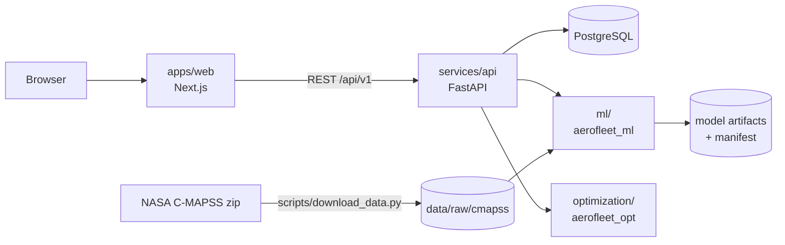

# AeroFleet

Engine remaining-useful-life prediction and maintenance planning for a fictional airline.

> **NASA simulated engine data + fictional airline operations.** Engine sensor histories come from NASA's
> C-MAPSS turbofan degradation *simulation*. The airline (Northstar Air), aircraft, flights, costs and
> maintenance resources are synthetic. This is an educational decision-support simulator, not an
> airworthiness tool. RUL is a modelling target in cycles, not a certified maintenance limit.

**Status:** Phase 0 (scaffold) complete. See [PROGRESS.md](PROGRESS.md). No model, fleet data or
optimizer exists yet; app sections show a "Not built yet" placeholder until their phase lands.

## Architecture



| Path | Responsibility |
|---|---|
| `apps/web` | Next.js App Router UI (TypeScript strict, Tailwind, TanStack Query, Zod) |
| `services/api` | FastAPI service, SQLAlchemy models, Alembic migrations |
| `ml` | Dataset acquisition, preprocessing, training, evaluation, inference (`aerofleet_ml`) |
| `optimization` | Heuristic baseline and CP-SAT maintenance scheduler (`aerofleet_opt`) |
| `scripts` | Thin CLIs: data download (pipeline and seeding arrive in later phases) |
| `docs` | Architecture, assumptions, data provenance, decision records |

Details: [docs/architecture.md](docs/architecture.md).

## Requirements

- Python 3.12 and [uv](https://docs.astral.sh/uv/) 0.11+
- Node 22 and pnpm 10 (`corepack enable`)
- Docker (for PostgreSQL), or any local PostgreSQL 16

## Setup

```bash
make setup        # uv sync, pnpm install, create .env from .env.example
make db           # PostgreSQL 16 in Docker (also creates the aerofleet_test database)
make migrate      # apply Alembic migrations
make api          # http://localhost:8000  (OpenAPI docs at /docs)
make web          # http://localhost:3000  (second terminal)
```

All configuration is in the root `.env` (see `.env.example`); both the API and the web app read it.
`make help` lists every target. Commands run from the repository root.

Full stack in containers instead: `make up` (db + api + web), `make down` to stop.

## Dataset

```bash
make data
# or, with a manually downloaded archive:
uv run python scripts/download_data.py --source ~/Downloads/archive.zip
```

Downloads NASA PCoE entry 6, *Turbofan Engine Degradation Simulation*, verifies its SHA-256, extracts
the 12 data files and readme into `data/raw/cmapss/` (gitignored), writes `SOURCE.json` with per-file
checksums, and validates FD001. Either the distributed zip or the inner `CMAPSSData.zip` is accepted.
Source, citation and terms: [docs/data_provenance.md](docs/data_provenance.md).

## Tests and checks

```bash
make test         # pytest; DB tests use TEST_DATABASE_URL (a disposable database)
make lint         # ruff, ruff format, eslint, prettier
make typecheck    # mypy --strict, tsc --strict
make check        # lint + typecheck + test
make e2e          # Playwright; starts the API and a production web build
uv run pytest -m network   # downloads the real dataset and checks published counts
```

CI (`.github/workflows/ci.yml`) runs Python checks, web checks/build, Playwright against a live API and
Postgres, and a Docker Compose smoke test. A weekly job re-verifies the NASA download.

## Deployment

Planned for Phase 5 on free tiers only. The API image (`services/api/Dockerfile`) and web image
(`apps/web/Dockerfile`) are independent and configured entirely through environment variables.
