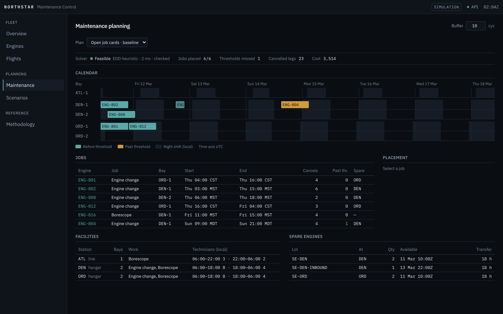
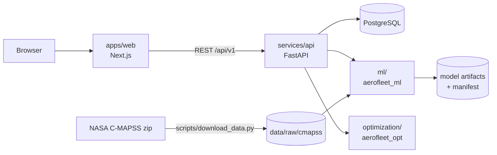

# AeroFleet

Engine remaining-useful-life prediction and maintenance planning for a fictional airline.

> **NASA simulated engine data + fictional airline operations.** Engine sensor histories come from NASA's
> C-MAPSS turbofan degradation *simulation*. The airline (Northstar Air), aircraft, flights, costs and
> maintenance resources are synthetic. This is an educational decision-support simulator, not an
> airworthiness tool. RUL is a modelling target in cycles, not a certified maintenance limit.


## The problem

An engine's remaining useful life (RUL) is uncertain, and taking it off-wing has a price: a hangar
bay, a technician crew, a spare engine, and the flights the aircraft can no longer fly. AeroFleet
connects the two halves of that decision:

1. **Predict.** A gradient-boosted model trained on NASA C-MAPSS estimates each engine's RUL with a
   calibrated 90% interval. The planner compares the *lower bound* with the cycles the engine is
   scheduled to fly this week.
2. **Plan.** Every engine that won't make it gets a job card. A CP-SAT model schedules those jobs
   into bays, shifts and spare-engine stock so that the fewest flights are cancelled. It is measured
   against a plain earliest-due-date heuristic on the same inputs.
3. **Explain.** Each placement says why it is where it is. When a scenario cannot be satisfied, the
   app names the minimal set of engines that conflict and the resource they compete for.

Pages: fleet overview, engine list and detail (prediction history, raw sensors, provenance), flight
schedule with rotations, maintenance calendar, scenario runner with baseline-vs-optimized
comparison, and a methodology page with the measured model metrics.
A guided walkthrough is in [docs/demo.md](docs/demo.md).

## Model results (NASA C-MAPSS FD001, official test split)

Last observed cycle of each of 100 test engines; RUL in cycles. Measured by `make pipeline`.

| Model | RMSE | MAE | PHM08 score |
|---|---|---|---|
| Constant (mean) | 43.24 | 35.91 | 35,723 |
| Linear on cycle | 33.52 | 27.78 | 5,820 |
| Ridge | 16.89 | 13.68 | 470 |
| **HistGradientBoosting** (selected) | **11.44** | **8.35** | **200** |

All models trained on RUL capped at 125. 90% conformal intervals: 90.0% empirical coverage, mean width
43.9 cycles. Engine-level splits; the test split was not used for any choice.
Details and caveats: [docs/model_card.md](docs/model_card.md).

## Maintenance optimization

Schedules one job per flagged engine (engine change or borescope) over the week, against fixed
flights, hangar bays, technician shifts and spare-engine stock. A transparent earliest-due-date
baseline and an OR-Tools CP-SAT model share the same options and costs; every plan is re-checked by
an independent constraint checker. Infeasible scenarios return the minimal set of conflicting jobs
and the resources they share. Details: [docs/optimization.md](docs/optimization.md).

| Scenario (real seeded fleet) | Baseline cost | Optimized cost | Cancelled legs | Status |
|---|---|---|---|---|
| Default week | 3,514 | 3,102 (−12%) | 23 → 19 | OPTIMAL, ~0.1 s |
| Inbound spare +24 h | 4,214 | 3,802 (−10%) | 24 → 20 | OPTIMAL |
| DEN bay out | 3,862 | 3,362 (−13%) | 23 → 16 | OPTIMAL |
| Hard threshold, DEN bay out | — | — | — | INFEASIBLE: ENG-802 and ENG-808 both need the one DEN bay before 13:45Z |

Costs are fictional units under stated weights (assumption O16).



## Architecture



| Path | Responsibility |
|---|---|
| `apps/web` | Next.js App Router UI (TypeScript strict, Tailwind, TanStack Query, Zod) |
| `services/api` | FastAPI service, SQLAlchemy models, Alembic migrations |
| `ml` | Dataset acquisition, preprocessing, training, evaluation, inference (`aerofleet_ml`) |
| `optimization` | Heuristic baseline and CP-SAT maintenance scheduler (`aerofleet_opt`) |
| `scripts` | Thin CLIs: data download, training pipeline, demo seed |
| `docs` | Architecture, assumptions, data provenance, decision records |

Details: [docs/architecture.md](docs/architecture.md).

## Requirements

- Python 3.12 and [uv](https://docs.astral.sh/uv/) 0.11+
- Node 22 and pnpm 10 (`corepack enable`)
- Docker (for PostgreSQL), or any local PostgreSQL 16

## Setup

```bash
make setup        # uv sync, pnpm install, create .env from .env.example
make db           # PostgreSQL 16 in Docker (also creates the aerofleet_test database)
make migrate      # apply Alembic migrations
make data         # NASA C-MAPSS (see Dataset)
make pipeline     # train the model (see Training)
make seed         # fictional fleet + NASA engines + model predictions (idempotent)
make api          # http://localhost:8000  (OpenAPI docs at /docs)
make web          # http://localhost:3000  (second terminal)
```

All configuration is in the root `.env` (see `.env.example`); both the API and the web app read it.
`make help` lists every target. Commands run from the repository root.

Full stack in containers instead: `make up` (db + api + web), then `make seed` from the host
(it writes to the containerised Postgres on port 5432). `make down` to stop.

API reference with example responses: [docs/api.md](docs/api.md).

## Dataset

```bash
make data
# or, with a manually downloaded archive:
uv run python scripts/download_data.py --source ~/Downloads/archive.zip
```

Downloads NASA PCoE entry 6, *Turbofan Engine Degradation Simulation*, verifies its SHA-256, extracts
the 12 data files and readme into `data/raw/cmapss/` (gitignored), writes `SOURCE.json` with per-file
checksums, and validates FD001. Either the distributed zip or the inner `CMAPSSData.zip` is accepted.
Source, citation and terms: [docs/data_provenance.md](docs/data_provenance.md).
Columns and derived fields: [docs/data_dictionary.md](docs/data_dictionary.md).

## Training

```bash
make pipeline     # train, select, calibrate, evaluate, save -> ml/artifacts/<version>/
make reproduce    # re-run and assert the committed metrics are reproduced
```

`model.joblib` is gitignored; `manifest.json` (data checksums, split, features, params, calibration)
and `metrics.json` are committed. `ml/artifacts/LATEST` names the current version.

## Tests and checks

```bash
make test         # pytest (synthetic fixtures; DB tests use TEST_DATABASE_URL) + vitest
make lint         # ruff, ruff format, eslint, prettier
make typecheck    # mypy --strict, tsc --strict
make check        # lint + typecheck + test
make e2e          # Playwright against the seeded demo (make data pipeline migrate seed first)
uv run pytest -m "network or dataset"   # real download + pipeline reproducibility
```

CI (`.github/workflows/ci.yml`) runs Python checks, web checks/build, Playwright against a live API and
Postgres, a Docker Compose smoke test, and an ML job that downloads the real data, re-trains, and
fails if committed metrics are not reproduced.

Accessibility: every page passes axe (WCAG 2.1 A/AA) on desktop and a phone viewport, checked in
the Playwright suite (`e2e/a11y.spec.ts`). Latency and bundle sizes: [docs/performance.md](docs/performance.md).

## Deployment

Configured for free tiers and not yet deployed: Postgres on Neon, the API on a Render free web
service (`render.yaml`, Docker), and the web app on Vercel. The hosted API only needs the
database. You run the data download, training and seeding on your own machine against the hosted
database. Steps, limits and post-deploy checks: [docs/deployment.md](docs/deployment.md).

## Decisions and tradeoffs

- **Plan on the lower bound, not the point estimate.** A 90% conformal interval is cheap to
  calibrate and gives a planning rule people can reason about ("flag when the pessimistic case runs
  out"). The cost is more early removals; the buffer control makes that trade visible.
  ([ADR 0002](docs/decisions/0002-rul-model-and-intervals.md))
- **CP-SAT over a MIP or a metaheuristic.** Scheduling with bays, shifts and discrete flight
  cancellations is naturally a constraint model with optional intervals. CP-SAT proves optimality at
  this size in well under a second, and its assumption literals give minimal infeasible cores for
  free. ([ADR 0003](docs/decisions/0003-maintenance-scheduling-model.md))
- **Hourly slots and a fixed flight schedule.** Jobs start on the hour and flights are never
  re-timed or swapped between aircraft; a job that overruns a ground gap cancels a contiguous block
  of legs. This is coarser than a real ops tool but keeps the model small and auditable.
- **An independent checker.** Both plans are re-verified against every constraint by separate code,
  so a modelling bug shows up as a failed check rather than a wrong number.
- **Synthetic operations, real engines.** The airline, costs and resources are invented and
  documented as assumptions ([docs/assumptions.md](docs/assumptions.md)). The engine data and model
  metrics are real and reproducible (`make reproduce`).

## Limitations

- One engine per aircraft is modelled, and engines are NASA test units mapped onto fictional
  tails. Cycles are flights, not certified life-limited-part counts.
- FD001 only (one operating condition, one fault mode). The model is not validated on other subsets.
- Costs are fictional units with stated weights; the optimizer is only as right as those weights.
- One-week horizon, no re-planning as the week unfolds.

## Documentation

| Doc | Contents |
|---|---|
| [architecture.md](docs/architecture.md) | Components, data flow, ER diagram |
| [model_card.md](docs/model_card.md) | Model, metrics, intervals, caveats |
| [optimization.md](docs/optimization.md) | Scheduling model, costs, measured scenarios |
| [assumptions.md](docs/assumptions.md) | Every synthetic assumption, numbered |
| [api.md](docs/api.md) | Endpoints with captured example responses |
| [data_provenance.md](docs/data_provenance.md), [data_dictionary.md](docs/data_dictionary.md) | Dataset source, terms, columns |
| [deployment.md](docs/deployment.md), [performance.md](docs/performance.md) | Hosting and measurements |
| [demo.md](docs/demo.md) | Walkthrough and video plan |
| [decisions/](docs/decisions) | Architecture decision records |

Screenshots are regenerated with `node apps/web/scripts/screenshots.mjs` against a running
production build and API.
