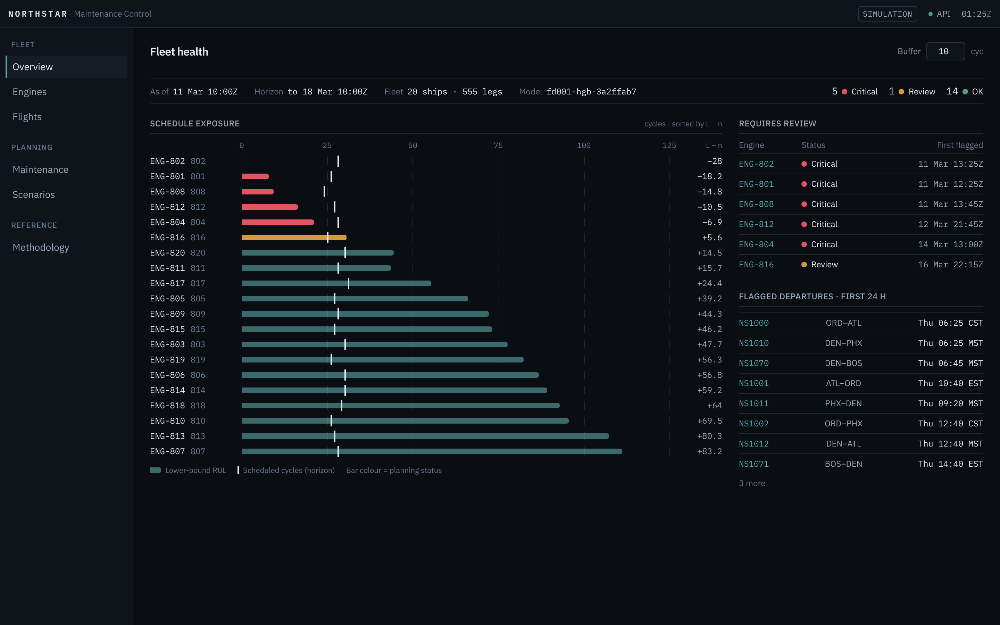
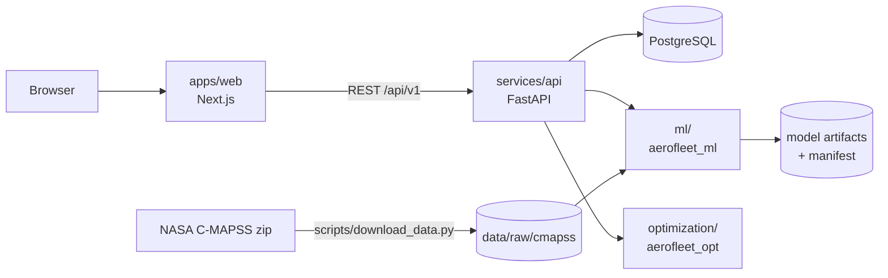

# AeroFleet

Engine remaining-useful-life prediction and maintenance planning for a fictional airline.

> **NASA simulated engine data + fictional airline operations.** Engine sensor histories come from NASA's
> C-MAPSS turbofan degradation *simulation*. The airline (Northstar Air), aircraft, flights, costs and
> maintenance resources are synthetic. This is an educational decision-support simulator, not an
> airworthiness tool. RUL is a modelling target in cycles, not a certified maintenance limit.

**Status:** Phases 0–3 complete (scaffold, ML pipeline, airline simulation + fleet API, fleet UI). See
[PROGRESS.md](PROGRESS.md). The maintenance optimizer and its pages arrive in Phase 4.



## Model results (NASA C-MAPSS FD001, official test split)

Last observed cycle of each of 100 test engines; RUL in cycles. Measured by `make pipeline`.

| Model | RMSE | MAE | PHM08 score |
|---|---|---|---|
| Constant (mean) | 43.24 | 35.91 | 35,723 |
| Linear on cycle | 33.52 | 27.78 | 5,820 |
| Ridge | 16.89 | 13.68 | 470 |
| **HistGradientBoosting** (selected) | **11.44** | **8.35** | **200** |

All models trained on RUL capped at 125. 90% conformal intervals: 90.0% empirical coverage, mean width
43.9 cycles. Engine-level splits; the test split was not used for any choice.
Details and caveats: [docs/model_card.md](docs/model_card.md).

## Architecture



| Path | Responsibility |
|---|---|
| `apps/web` | Next.js App Router UI (TypeScript strict, Tailwind, TanStack Query, Zod) |
| `services/api` | FastAPI service, SQLAlchemy models, Alembic migrations |
| `ml` | Dataset acquisition, preprocessing, training, evaluation, inference (`aerofleet_ml`) |
| `optimization` | Heuristic baseline and CP-SAT maintenance scheduler (`aerofleet_opt`) |
| `scripts` | Thin CLIs: data download, training pipeline, demo seed |
| `docs` | Architecture, assumptions, data provenance, decision records |

Details: [docs/architecture.md](docs/architecture.md).

## Requirements

- Python 3.12 and [uv](https://docs.astral.sh/uv/) 0.11+
- Node 22 and pnpm 10 (`corepack enable`)
- Docker (for PostgreSQL), or any local PostgreSQL 16

## Setup

```bash
make setup        # uv sync, pnpm install, create .env from .env.example
make db           # PostgreSQL 16 in Docker (also creates the aerofleet_test database)
make migrate      # apply Alembic migrations
make data         # NASA C-MAPSS (see Dataset)
make pipeline     # train the model (see Training)
make seed         # fictional fleet + NASA engines + model predictions (idempotent)
make api          # http://localhost:8000  (OpenAPI docs at /docs)
make web          # http://localhost:3000  (second terminal)
```

All configuration is in the root `.env` (see `.env.example`); both the API and the web app read it.
`make help` lists every target. Commands run from the repository root.

Full stack in containers instead: `make up` (db + api + web), then `make seed` from the host
(it writes to the containerised Postgres on port 5432). `make down` to stop.

API reference with example responses: [docs/api.md](docs/api.md).

## Dataset

```bash
make data
# or, with a manually downloaded archive:
uv run python scripts/download_data.py --source ~/Downloads/archive.zip
```

Downloads NASA PCoE entry 6, *Turbofan Engine Degradation Simulation*, verifies its SHA-256, extracts
the 12 data files and readme into `data/raw/cmapss/` (gitignored), writes `SOURCE.json` with per-file
checksums, and validates FD001. Either the distributed zip or the inner `CMAPSSData.zip` is accepted.
Source, citation and terms: [docs/data_provenance.md](docs/data_provenance.md).
Columns and derived fields: [docs/data_dictionary.md](docs/data_dictionary.md).

## Training

```bash
make pipeline     # train, select, calibrate, evaluate, save -> ml/artifacts/<version>/
make reproduce    # re-run and assert the committed metrics are reproduced
```

`model.joblib` is gitignored; `manifest.json` (data checksums, split, features, params, calibration)
and `metrics.json` are committed. `ml/artifacts/LATEST` names the current version.

## Tests and checks

```bash
make test         # pytest (synthetic fixtures; DB tests use TEST_DATABASE_URL) + vitest
make lint         # ruff, ruff format, eslint, prettier
make typecheck    # mypy --strict, tsc --strict
make check        # lint + typecheck + test
make e2e          # Playwright against the seeded demo (make data pipeline migrate seed first)
uv run pytest -m "network or dataset"   # real download + pipeline reproducibility
```

CI (`.github/workflows/ci.yml`) runs Python checks, web checks/build, Playwright against a live API and
Postgres, a Docker Compose smoke test, and an ML job that downloads the real data, re-trains, and
fails if committed metrics are not reproduced.

## Deployment

Planned for Phase 5 on free tiers only. The API image (`services/api/Dockerfile`) and web image
(`apps/web/Dockerfile`) are independent and configured entirely through environment variables.
