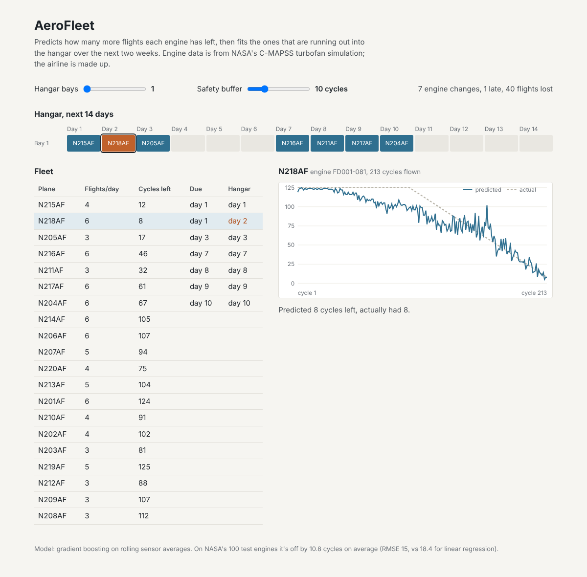

# AeroFleet

A small airplane maintenance planner. It predicts how many more flights each engine has before it
wears out, then schedules the ones that are running low into a limited number of hangar bays over
the next two weeks.



## How it works

**Prediction.** The engine data is NASA's [C-MAPSS](https://www.nasa.gov/intelligent-systems-division/discovery-and-systems-health/pcoe/pcoe-data-set-repository/)
turbofan dataset (FD001), which is simulated engines run until they fail. `model/train.py` trains a
gradient boosting model on 30-cycle rolling averages and trends of the sensors to predict remaining
useful life (RUL) in cycles. On the 100 official test engines it gets an RMSE of 15.0 cycles,
compared with 18.4 for plain linear regression.

**Fleet.** 20 test engines are assigned to made-up planes that each fly 3 to 6 legs a day. One leg
uses one engine cycle.

**Scheduling.** A plane is due for an engine change on the last day it can fly without dipping below
the safety buffer. Jobs are handled earliest-due first. Each one goes in a bay on its due day, or the
closest free day before it. If the hangar is booked up until then, it goes on the next free day after
and counts as late, and the plane is grounded until then. Each change takes one bay for one day.

You can change the number of bays and the buffer with the sliders, and the schedule updates live.

## Running it

```sh
# retrain and regenerate web/public/fleet.json (optional, it's committed)
pip install -r model/requirements.txt
python model/train.py

# website
cd web
npm install
npm run dev
npm test
```

It's a static site, so it deploys to Vercel (or anywhere) with no backend.
