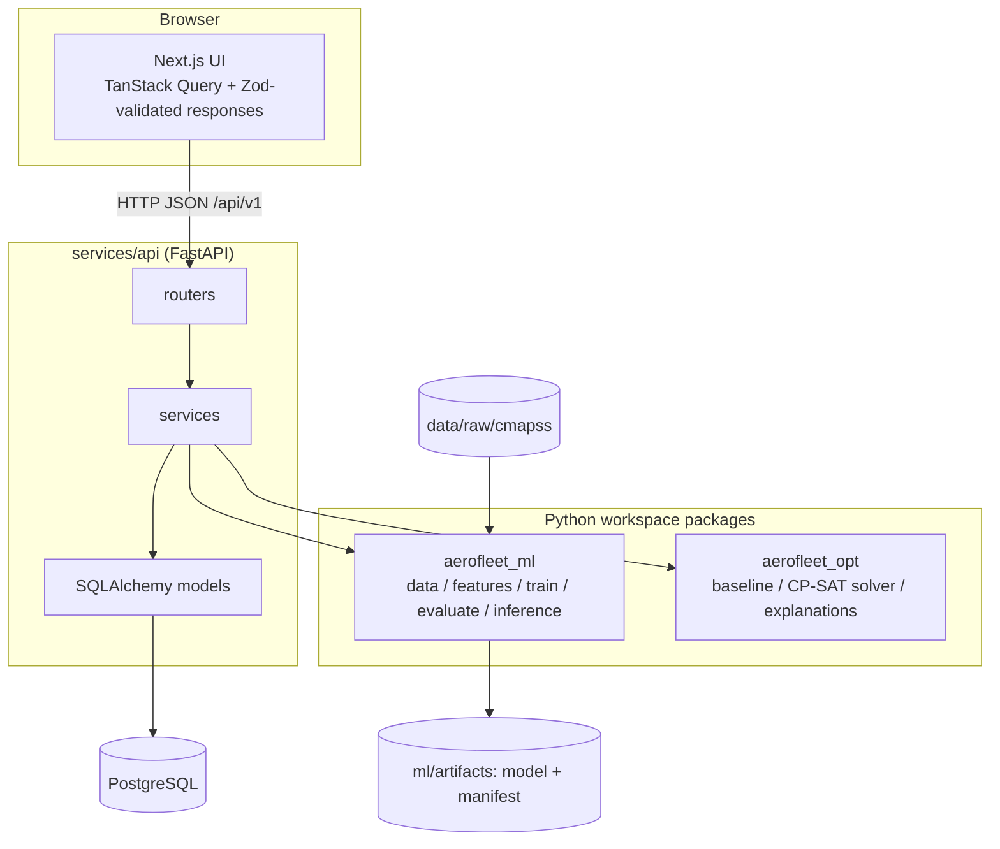
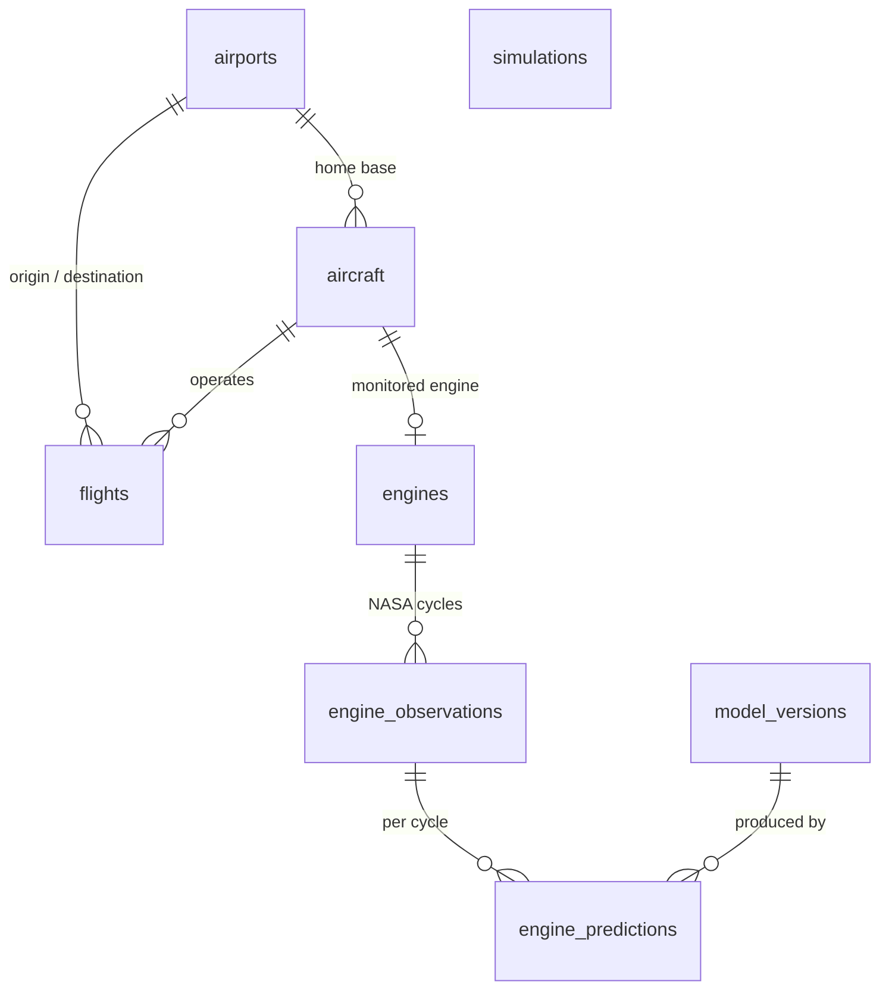

# Architecture

## Components



- **One deployable API, not microservices.** `aerofleet_ml` and `aerofleet_opt` are plain Python
  packages in a uv workspace. The API imports them; each is tested independently.
- **Synchronous first.** Optimization runs inside a request with a solver time limit. A job/poll
  pattern is added only if measured solve times require it (spec §2).
- **Configuration** comes only from environment variables (`.env` at the repo root locally).
  Invalid configuration fails at startup.
- **Time** is stored in UTC; the UI converts to airport-local time with zone labels.

## Data model



- `engine_observations` hold NASA rows verbatim (3 settings + 21 sensors as arrays).
- `engine_predictions` are written at seed time by the trained `RulPredictor`, keyed by
  (engine, cycle, model version), so every number in the API traces to a model version.
- `model_versions` stores the artifact's manifest and measured metrics (JSONB); one is active.
- `simulations` records the seed, horizon and generator version of the fictional schedule.
- Seeding (`make seed`) deletes and rebuilds all of the above in one transaction.

## Planning flags

For each engine: R = predicted RUL, L = lower bound, n = scheduled legs from the simulation start.
Margins R − n and L − n; status from L − n against the buffer (see assumptions O11). Computed per
request from stored predictions and flights, so a different `buffer` needs no reseed.

## Health check

`GET /health` runs `SELECT 1`. It returns `200 {"status":"ok","database":"ok"}` or
`503 {"status":"degraded","database":"unavailable"}` with the same schema. The web status rail polls it
every 30 s and distinguishes *API unreachable* from *database unavailable*.

## Frontend shell

- Status rail: wordmark, persistent `Simulation` label (links to Methodology), API status, UTC clock.
- Left navigation grouped by task (Fleet / Planning / Reference); becomes a horizontal strip on
  narrow screens.
- Design tokens live in `apps/web/app/globals.css` (`@theme`). Colour is reserved for state:
  teal = selection/interactive, green/amber/red = status. Typeface: IBM Plex Sans / Mono, tabular
  numerals on by default.

## Repository layout

```text
apps/web/              Next.js app (app/, components/, lib/, e2e/)
services/api/          FastAPI app (app/), Alembic (migrations/), tests/
ml/                    src/aerofleet_ml, tests/
optimization/          src/aerofleet_opt, tests/
scripts/               CLIs
infra/postgres/        container init SQL
docs/                  this folder; decisions/ holds ADRs
data/                  raw/ and processed/ (gitignored)
```
